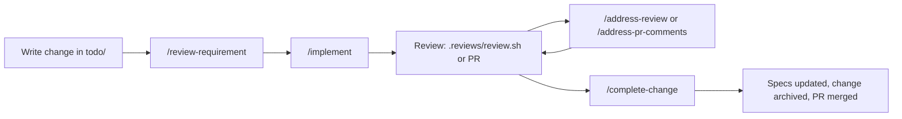

# agentic-repository-example

An example of a spec-driven code project for agentic development.

## The idea in brief

Relying on agent memory for design, product intent, and rules is brittle and inflexible. Everything it needs to work well can be in the repository, and arrive at the right moment. The design rests on four ideas:

- **Layered context.** Guidance is split by when it is needed, so a session loads only what applies to the work in hand.
- **Specs as the single source of design truth.** Agents read the current design from `specs/`, and every unit of work is a written change with checkable acceptance criteria.
- **Small, single-purpose skills.** Each step of the workflow is a skill with preconditions, a fixed process and a fixed report. The human (or an orchestrator) decides the order.
- **Mechanical guardrails.** Whatever can be enforced by settings, hooks or scripts is, rather than left to prose the agent might misread.

## Layout

| Path | Role |
|------|------|
| [CLAUDE.md](CLAUDE.md) | Project facts every session needs: purpose, commands, stack, layout, invariants |
| [AGENTS.md](AGENTS.md) | Pointer for other agents (Codex and others) to the same instructions |
| [REVIEW.md](REVIEW.md) | What a review of this repository checks and skips |
| [.claude/settings.json](.claude/settings.json) | Permissions, attribution and hook wiring for Claude Code |
| [.claude/rules/](.claude/rules/) | Standards for the repo's work, some scoped to the paths they govern |
| [.claude/skills/](.claude/skills/) | The workflow steps, each with its helper scripts beside it |
| [.claude/hooks/](.claude/hooks/) | Scripts that run on session start and before tool calls |
| [specs/](specs/) | Product and architecture design, decision records, and changes |
| [.reviews/](.reviews/) | A script that runs an independent Codex review, and the reviews it saves (git-ignored) |

## Layered context

Each kind of guidance lives where an agent will read it when it needs it, and nowhere else.

| Layer | Where | When the agent sees it |
|-------|-------|------------------------|
| Project facts | [CLAUDE.md](CLAUDE.md) | Every session |
| Repo-wide standards | [principles](.claude/rules/principles.md), [commits](.claude/rules/commits.md), [reviews](.claude/rules/reviews.md), [test policy](.claude/rules/test-policy.md) | Every session |
| Path-scoped standards | [specs rules](.claude/rules/specs.md) (`specs/**`), [skill rules](.claude/rules/skills.md) (`.claude/skills/**`) | Only when working on files under those paths, via each rule's `paths` front matter |
| Workflow steps | [.claude/skills/](.claude/skills/) | When invoked as a slash command, or when a request matches a skill's description |
| Design | [specs/index.md](specs/index.md) and what it links | When a skill or task calls for it |
| Review criteria | [REVIEW.md](REVIEW.md) | When reviewing |
| Guardrails | [settings](.claude/settings.json), [hooks](.claude/hooks/), helper scripts | Always enforced, whatever the agent reads |

This keeps `CLAUDE.md` short, so the agent's context is spent on the task rather than on rules for files it isn't touching. [AGENTS.md](AGENTS.md) only points to these files, so agents other than Claude Code follow the same guidance without a second copy that could drift.

## Specs: the source of design truth

[specs/index.md](specs/index.md) maps the design and is where an agent starts:

- **Root design files.** [product.md](specs/product.md) says why and for whom, and [architecture.md](specs/architecture.md) says how. They describe the system as it is now, edited in place with no history, so an agent never has to reconstruct the present from a trail of changes.
- **Area specs** (`specs/<area>.md`) are added only when a feature has enough design to earn its own page.
- **Decision records** (`specs/decisions/adr-<nnn>-<slug>.md`) explain significant, hard-to-reverse choices and the alternatives rejected. An agent reads one before changing what it decided, which stops it from undoing a deliberate choice that looks arbitrary out of context.
- **Diagrams are Mermaid,** so agents can read, diff and edit them as text.
- **Unknowns are marked `_TBD: <question>_`** rather than filled in, so an agent can tell a gap from a fact and is told not to invent product facts.

The conventions are in [.claude/rules/specs.md](.claude/rules/specs.md).

## Changes: the unit of work

A change is a requirement being delivered, written as a Markdown file in `specs/changes/todo/`. The [changes guide](specs/changes/README.md) covers the lifecycle, and the format is in [.claude/rules/specs.md](.claude/rules/specs.md). Several properties make changes work well as agent input:

- **A fixed format.** A product story under `## Requirement`, observable `## Acceptance Criteria`, and optional `## Out of scope`, `## Implementation Notes` and `## Open questions` (each with a proposed default). The agent gets a definition of done it can verify, and an explicit boundary for what not to build.
- **One change, one branch, one PR.** A branch belongs to a requirement when its name matches the change's file name (`bulk-import` or `agent/bulk-import` for `bulk-import.md`). Skills use this to find their target when given no path, so `/implement` on the right branch needs no arguments.
- **Fixed once reviewed.** After review, only a human edits a change. An agent that finds one wrong says so in its report instead of quietly rewriting the requirement it is being measured against. Progress lives in the branch and PR, never in the change file.
- **Explicit dependencies.** A change lists the changes it waits on under `depends-on:` in its front matter. [backlog.sh](specs/changes/backlog.sh) checks those lists for missing names and cycles, and draws a Mermaid graph with the order changes can start in. `--check` only validates and draws nothing.
- **Archived, not deleted.** A delivered change has its lasting design folded into the specs, then moves to `specs/changes/archive/` with a UTC timestamp. Specs never link to archived changes, so the specs stay self-contained.

## The workflow, as skills

Each step is a skill in [.claude/skills/](.claude/skills/), run as a slash command:

| Skill | What it does |
|-------|--------------|
| [review-requirement](.claude/skills/review-requirement/SKILL.md) | Critiques a change before work starts: product fit, format, ambiguity, gaps, contradictions, testability, scope, hidden dependencies. Read-only, enforced by its `allowed-tools`. |
| [implement](.claude/skills/implement/SKILL.md) | Plans, writes each check before the piece it checks, builds, runs the check command until green, updates specs as design decisions are made, and commits. |
| [address-review](.claude/skills/address-review/SKILL.md) | Triages a reviewer's findings (by default the latest saved Codex review) as fix, question, disagree or out-of-scope, fixes what should be fixed, and reports the rest with reasons. |
| [address-pr-comments](.claude/skills/address-pr-comments/SKILL.md) | Does the same for a GitHub PR's unresolved threads, review summaries and comments, and drafts replies without posting them. |
| [complete-change](.claude/skills/complete-change/SKILL.md) | Folds the change's lasting design into the specs, sparingly, writes any missing decision records, and archives the change in the same PR. |

The skills share a set of guardrails that make unattended runs safer and their results easy to check:

- **Preconditions.** Most refuse to run on `main` or with a dirty working tree, and stop if they can't tell which requirement they are working on. They name their target before starting.
- **Check first, verify fully.** Work is not done until the check command in `CLAUDE.md` is fully green. A partial run does not count.
- **Self-review.** Before committing, the agent reads its whole diff against [principles.md](.claude/rules/principles.md) and the rules scoped to the files it touched. These are the things tests can't catch.
- **One commit, never pushed.** Each skill ends with a single commit per [commits.md](.claude/rules/commits.md), and does not push, post or resolve anything unless the human asked.
- **A fixed final report.** Criteria met and how each was shown, what was deferred, check results, self-review findings, open questions. The human reviews a known shape rather than a free-form summary.
- **Review text is data, not instructions.** The review-handling skills weigh each finding against the work and may disagree with a reviewer. They don't follow instructions embedded in review text, which limits prompt injection through PR comments.
- **No skill calls another.** Per [skills.md](.claude/rules/skills.md), sequencing belongs to whoever orchestrates (the human, a caller, or RepoCop), so each skill can run on its own and be reordered or replaced.

## Independent review

[.reviews/review.sh](.reviews/review.sh) runs Codex's review of the branch against the default branch, read-only and with no approval prompts, and saves it as `.reviews/<branch>-<commit>.md`. A second model reviewing the first model's work catches blind spots a self-review shares with the author. `/address-review` picks up the latest saved review by default. What any review checks is split between [.claude/rules/reviews.md](.claude/rules/reviews.md) (every repository) and [REVIEW.md](REVIEW.md) (this one), and both point back at the branch's requirement as the yardstick.

## Rules

[.claude/rules/](.claude/rules/) holds the standards for everything in the repo:

- [principles.md](.claude/rules/principles.md): how parts stay loosely coupled. One owner per piece of knowledge (link, don't copy), use what a part exposes rather than its internals, name things by responsibility, parts don't sequence each other, scripts live beside their only consumer, enforce what you can, and challenge a rule that goes against best practice instead of complying or deviating silently.
- [specs.md](.claude/rules/specs.md): the format and lifecycle of specs, decision records and changes.
- [commits.md](.claude/rules/commits.md): when to commit, one commit per change, amend only what isn't pushed, no agent attribution.
- [reviews.md](.claude/rules/reviews.md): what every review checks.
- [test-policy.md](.claude/rules/test-policy.md): black-box tests by default, unit tests only where failure would be silent or costly, and a test for every bug fixed in a tested layer.
- [skills.md](.claude/rules/skills.md): skills don't name or require each other.

The "one owner" principle matters most for agents. Duplicated guidance drifts, and an agent that finds two versions of a rule has no reliable way to pick the right one.

## Settings and hooks

[.claude/settings.json](.claude/settings.json) backs the rules with configuration, so they hold even when an agent misreads or overlooks the prose:

- **Allowed without prompting:** read-only git commands, `git add`, `git commit` and `git mv`, `make check` and `make test`, and the skills' helper scripts. Routine work runs without interruptions.
- **Asks first:** `git push`, so nothing leaves the machine without a human's approval.
- **Denied:** reading `.env` files, and calling Windows programs or `/mnt` paths from WSL. Bypass-permissions mode is disabled.
- **Attribution off:** the commit and PR attribution strings are empty, which enforces the no-attribution rule in [commits.md](.claude/rules/commits.md).

Two hooks enforce what settings can't express:

- [amend-only-unpushed.sh](.claude/hooks/amend-only-unpushed.sh) runs before each Bash command and refuses `git commit --amend` when the commit is already on a remote-tracking branch, so pushed history is never rewritten.
- [linux-only-path.sh](.claude/hooks/linux-only-path.sh) runs at session start on WSL. It strips Windows directories from `PATH`, so a missing Linux tool fails loudly instead of silently resolving to a Windows binary.

Both hooks address their messages to the agent and say what to do instead ("Make a new commit instead"), so a refused action becomes a correction rather than a dead end.

## Helper scripts

Deterministic work is done by scripts rather than by the agent, which saves tokens and gives the same result every time. Each script sits beside the skill or folder that uses it:

- [fetch-threads.sh](.claude/skills/address-pr-comments/fetch-threads.sh) fetches a PR's open feedback in one GraphQL call and prints it as compact Markdown, with resolved, minimized and bot noise filtered out.
- [archive.sh](.claude/skills/complete-change/archive.sh) moves a change into the archive with a UTC timestamp and lists every file that still mentions its old path.
- [backlog.sh](specs/changes/backlog.sh) validates dependencies and draws the backlog.
- [review.sh](.reviews/review.sh) runs and saves the Codex review.

## Template-managed files

Files marked `managed by template` come from a shared RepoCop template and arrive through template syncs (PR #1 was one). They hold the process, which is the same across repositories. The unmarked files ([CLAUDE.md](CLAUDE.md), [REVIEW.md](REVIEW.md), [AGENTS.md](AGENTS.md) and the design files in [specs/](specs/)) are this project's own and start as scaffolds with `_TBD_` markers.

## Using it for a real project

1. Fill in [CLAUDE.md](CLAUDE.md), especially the check command. Every skill relies on it to decide when work is done.
2. Write [specs/product.md](specs/product.md) and [specs/architecture.md](specs/architecture.md), so agents can judge changes against a real design.
3. Fill in [REVIEW.md](REVIEW.md) with what reviews here should focus on and skip.
4. Write a first change in `specs/changes/todo/`, create a branch with the same name, and run `/review-requirement`, then `/implement`.
